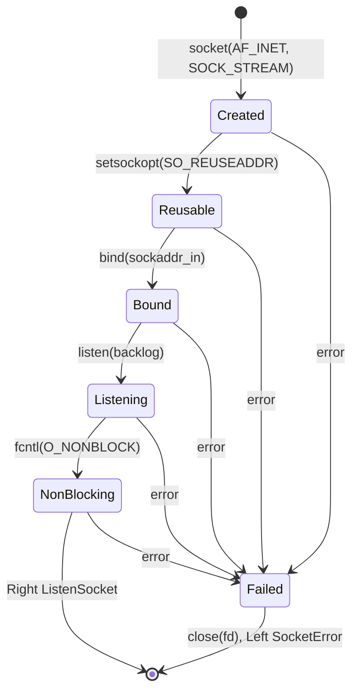
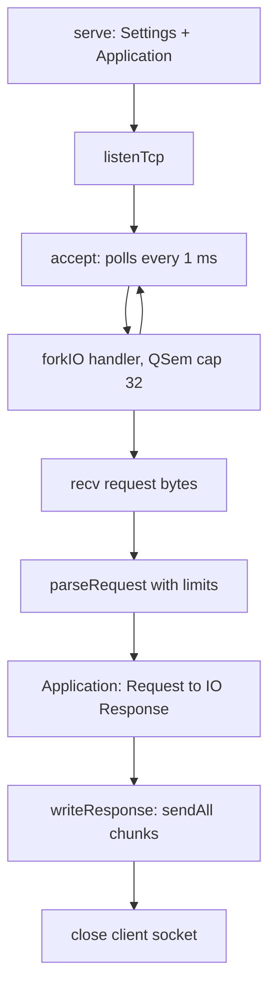
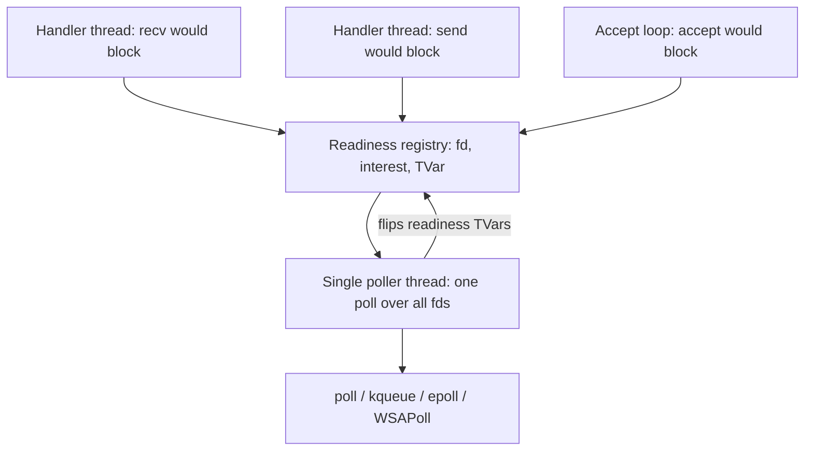

# MicroHttp Network Design

This document describes the networking subsystem as it exists and the target
architecture it is moving toward. It spans `MicroHttp.Network.Socket` and
`MicroHttp.Server`, with touchpoints in `MicroHttp.Http.Parser` and
`MicroHttp.Http.Response`. The original per-module contracts are preserved in
`docs/initial-module-design/` and are not updated; this document is living.

Change plans referenced here:

- [RFC-0003](../rfcs/rfc-0003-socket-correctness-and-testability.md) covers
  request framing and socket testability.
- The readiness manager, performance harness, portability backends, and GHC
  support described under future direction do not have RFCs yet.

## Network Design Constraints

The design is shaped by the MicroHs runtime:

- Threads are green threads scheduled by the runtime on effectively one
  operating-system thread. A blocking syscall blocks every thread.
- There is no IO manager: no `threadWaitRead`, and no integration between
  file-descriptor readiness and the scheduler.
- STM is available (`TVar`, `TMVar`, `TQueue`, `TBQueue`, `atomically`,
  `retry`), as are `forkIO`, `MVar`, and `QSem`.

Consequences: every socket is set non-blocking, and every potentially
blocking operation is a retry loop that sleeps one millisecond on
`EAGAIN`/`EWOULDBLOCK`. Errors are returned as `Either SocketError`
(ADR-009), never thrown.

## Listening Socket State Machine

`listenTcp` walks a fixed syscall pipeline. Failure at any step closes the
file descriptor and returns the failing operation's name and errno.

The bind address is a hand-built sixteen-byte `sockaddr_in`. The current
layout is the BSD form with a length byte at offset zero, which is correct
on macOS only; Linux puts a sixteen-bit family at offset zero. RFC-0003
extracts this encoding as a pure function so per-platform layouts become a
unit-tested seam.

## Request Lifecycle

`serve` accepts in a loop and forks one green thread per connection, capped
by a semaphore. Each connection serves exactly one request (ADR-011).

Known gap: the current implementation performs a single `recv` of at most
8192 bytes, so segmented or large requests are truncated and
`settingsMaxBodyBytes` is unreachable. RFC-0003 replaces the single read
with a framed reader that consumes chunks until the header terminator and
declared `Content-Length` are satisfied, enforcing limits incrementally.
The framed reader is also the intended chunk source for future streaming
request bodies.

## Concurrency Model

Current model: one green thread per connection, non-blocking syscalls, and
per-operation polling. Every waiting operation sleeps one millisecond and
retries its own syscall, so the syscall and wakeup cost scales with the
number of waiting sockets, and every wait has a latency floor of up to one
millisecond.

Target model: a single readiness manager replaces per-operation polling.

Waiting operations register their file descriptor and interest, then block
in `atomically` with `retry` on a readiness `TVar`; the poller performs one
`poll` over all registered descriptors and flips the `TVar`s of ready ones.
Because a blocking `poll` FFI call would stall the whole runtime, the first
poller still sleeps between zero-timeout polls; this preserves the latency
floor but reduces cost to one syscall and one sleeper per tick regardless of
socket count. If MicroHs later provides a way to block in an FFI call
without stalling the runtime, the same architecture becomes event-driven by
changing the poller's timeout.

The performance harness should be built before the readiness manager so the
polling tax is measured, not assumed.

Known runtime finding: under MicroHs 0.16.0.0 (macOS arm64), forcing a
sufficiently large lazily constructed ByteString yields an empty value
once any other thread has been forked, even a thread that did nothing and
has already exited. The corrupt value is memoised, and every forcing
observer is affected (`BS.length` and `useAsCStringLen` both tested). The
boundary sits between 1024 bytes (correct) and 4096 bytes (corrupt).
`spike/MicroHttp/Spike11.hs` is a nine-line deterministic reproducer;
`spike/MicroHttp/Spike10.hs` preserves the socket-level manifestation it
was minimised from, where a sender received length zero for its payload,
sent nothing, and deadlocked with its polling receiver. `packCStringLen`
from FFI buffers, as used by `recv`, round-trips real bytes in the
loopback suite and appears unaffected.

No validated in-process userland workaround is known. Two earlier
candidates were withdrawn on closer testing: copying the bytes out under a
brief `useAsCStringLen` only masked the fault in the experiment that
appeared to validate it, and a pure pack-then-check-length-then-retry loop
can livelock, because the corrupting condition is phase-locked to the
reduction count, so a rebuilt-and-rewalked pack straddles the same slice
expiry and corrupts identically unless a scheduling perturbation is
introduced between attempts (which a pure function cannot do). The root
cause and the full diagnosis are in
[microhs-bytestring-bug-report.md](../microhs-bytestring-bug-report.md).

Current local mitigation: the MicroHs runtime is patched to make the
ByteString list-walk primitives non-preemptible. In
`src/runtime/eval.c`, `evalstring` and `evalbytestring` save `glob_slice`,
inflate it for the duration of the walk, and restore it afterwards, so the
walk cannot be rescheduled mid-flight and the zapped-argument re-execution
never happens. This trades latency (a large pack now runs without yielding)
for correctness, which is the accepted trade until upstream resolves it.
The patch lives in the developer's MicroHs checkout and its installed
mcabal copy, not in this repository; it must be reapplied after any MicroHs
reinstall. `spike/MicroHttp/Spike11.hs` and `spike/MicroHttp/Spike10.hs`
both pass under the patch and both fail without it, so they double as the
patch's regression check. Integration tests keep their single-threaded
transfer rounds for now; the readiness manager and performance harness work
should retest concurrency once upstream resolves the bug and the local
patch is dropped.

## Streaming Direction

Request and response bodies move to the iteratee and enumerator model per
[RFC-0004](../rfcs/rfc-0004-iteratee-streaming-io.md) and ADR-024:
producers (socket, file, strict value) are enumerators, consumers (framing,
handlers, the socket sink) are iteratees, and stream transformations such
as the Content-Length bound are enumeratees. Residual input lives in the
consumer's result and flows forward through monadic bind, so no producer
pushback exists; memory is bounded by chunk and header limits, never by
message size. The ingress pipeline is socket enumerator, header framing,
ingress enumeratees, then the handler iteratee; the egress pipeline is the
body enumerator, egress enumeratees, then the socket sink. Middleware
keeps its `Application -> Application` shape, with stream-touching
middleware lifting enumeratees onto one of the two pipelines.

## Portability Direction

Target platforms are macOS, Linux, and Windows.

- macOS and Linux differ only in the `sockaddr_in` layout and minor errno
  values; the pure encoder from RFC-0003 is the seam.
- Windows is a separate backend: Winsock startup, `SOCKET` handles,
  `closesocket`, `ioctlsocket(FIONBIO)` instead of `fcntl`, `WSAPoll`, and
  `WSAGetLastError` instead of errno.
- Divergence should live in compiler- or platform-specific module
  directories selected by include path, following the existing
  `test/ghc-compat/` pattern, rather than CPP.

## GHC Compatibility Direction

GHC is currently a coverage tool only: `make coverage` compiles `src/` and
the test suites with GHC and HPC. The server binary has never been built or
run under GHC. Elevating GHC to a supported platform requires:

- Migrating FFI signatures from `Int` to `Foreign.C.Types` (`CInt`,
  `CSize`): GHC's code generator does not guarantee the upper half of a
  64-bit read from a C `int` return. Both compilers provide
  `Foreign.C.Types`.
- Using `capi` for function imports as well as constants, which makes GHC
  check prototypes against headers and handles the variadic `fcntl`
  correctly.
- A `check-ghc` gate that builds and runs the suites, and a GHC build of the
  TestApp exercised by the browser smoke flow.

GHC support and OS portability share their seams: GHC runs on Linux and
Windows today, so a first-class GHC target provides CI coverage of all
compiler-independent code before MicroHs is proven on those platforms.

## Network Testing Strategy

- Pure units: sockaddr encoding, request framing over a scripted chunk
  source, `isWouldBlock` classification.
- Loopback integration: `connectTcp` plus `boundPort` (RFC-0003) enable
  in-process accept, round-trip, partial-send, peer-close, and error-mapping
  tests against real sockets on port zero.
- End to end: the TestApp browser smoke flow, and a future performance
  harness recording requests per second and latency percentiles under
  concurrent load.
